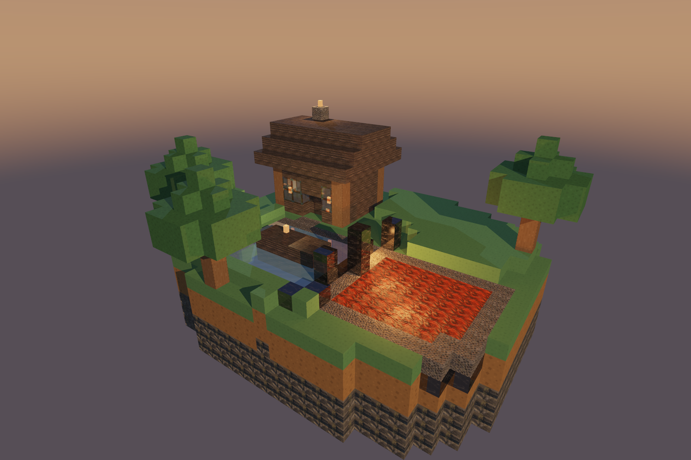

<h1 align="center">Diorama raytracing</h1>

<p align="center">
  <em>Raytracer por software en Rust. Una cabaña de madera junto a un estanque
  y un lago de lava, hecha enteramente de cubos, trazada rayo por rayo en CPU.</em>
</p>

<p align="center">
  
  
  
  
</p>

<p align="center">
  
</p>

## Video

<!-- TODO: enlace al video de la entrega -->

---

## Que es

Un raytracer escrito desde cero. No hay motor 3D, no hay GPU y no hay ninguna
libreria de graficos: `raylib` se usa unicamente para abrir la ventana, leer el
teclado y mostrar en pantalla el buffer de pixeles que ya calculo la CPU. Todo
lo demas (los vectores, las intersecciones, el sombreado, las sombras, la
reflexion, la refraccion, los mapas normales, la estructura de aceleracion y el
paralelismo) esta escrito a mano con la biblioteca estandar.

Es **raytracing recursivo**, no raycasting: cada rayo que choca puede generar
rayos nuevos (sombra, reflejo, refraccion) y el color final es el resultado de
todos ellos.

Cada pixel de la pantalla lanza un rayo. El rayo busca con que cubo choca
primero, calcula cuanta luz le llega a ese punto y, si el material lo pide,
genera rayos nuevos que se reflejan o atraviesan el material. El color que
regresa es el del pixel.

## Como se corre

```bash
cargo run --release
```

| Tecla | Que hace |
|-------|----------|
| ← → / A D | Rotar el diorama |
| ↑ ↓ | Subir y bajar el angulo de la camara |
| W S / rueda | Acercar y alejar |
| Q E | Bajar y subir el punto de vista |
| R | Encender o apagar el giro automatico |
| P | Guardar `captura.png` al doble de resolucion |
| H | Mostrar u ocultar el HUD |

Dos modos mas, sin ventana:

```bash
# Un solo cuadro a PNG
cargo run --release -- --snapshot

# Una vuelta completa como secuencia de cuadros, para el video
cargo run --release -- --orbit
ffmpeg -framerate 30 -i frames/%04d.png -c:v libx264 -pix_fmt yuv420p -crf 18 diorama.mp4
```

## La escena

```
              chimenea con brasas
                    |
            ╔═══════════════╗
            ║   cabaña de   ║   ventanas de cristal, lampara dentro
            ║    tablones   ║   troncos en las esquinas
            ╚══════╦════════╝
                   ║ camino de adoquin
        ~~~~~~~~~~~╨~~~~~     ▓▓     ████████████
        ~   estanque    ~     ▓▓     ██  lava   ██
        ~  con embarcadero~   ▓▓     ██ emisiva ██
        ~~~~~~~~~~~~~~~~~     ▓▓     ████████████
          fondo de arena       ▲       reborde de obsidiana
          refraccion 1.33      |
                        columnas de obsidiana
                        (reflejan la lava)
```

**3167 bloques colocados → 1173 cubos visibles.** El 63% restante esta enterrado
y se descarta sin que la imagen cambie en un solo pixel.

## Materiales

Trece materiales, cada uno con su propia textura y sus propios parametros.
Cuatro llevan ademas mapa de normales. Todas las texturas son CC0; el origen exacto de
cada una esta en [CREDITS.md](CREDITS.md).

| Material | Difuso | Especular | Reflexion | Refraccion | Exp. | IOR | Normal | Notas |
|----------|-------:|----------:|----------:|-----------:|-----:|----:|:------:|-------|
| pasto      | 0.95 | 0.02 | 0.00 | 0.00 |   3 |  -   |    | |
| tierra     | 0.92 | 0.02 | 0.00 | 0.00 |   3 |  -   |    | |
| piedra     | 0.88 | 0.06 | 0.00 | 0.00 |  10 |  -   | si | |
| adoquin    | 0.90 | 0.05 | 0.00 | 0.00 |   6 |  -   | si | |
| tablones   | 0.90 | 0.10 | 0.02 | 0.00 |  12 |  -   | si | |
| tronco     | 0.90 | 0.06 | 0.00 | 0.00 |   8 |  -   |    | |
| hojas      | 0.85 | 0.04 | 0.00 | 0.00 |   4 |  -   |    | |
| **agua**   | 0.30 | 0.60 | 0.26 | 0.50 | 180 | 1.33 |    | refracta |
| **lava**   | 0.12 | 0.08 | 0.00 | 0.00 |   4 |  -   | si | **emisiva**, con mascara |
| **obsidiana** | 0.15 | 0.70 | **0.60** | 0.00 | 220 |  -   |    | espejo |
| **cristal**| 0.05 | 0.50 | 0.10 | **0.85** | 250 | 1.50 |    | refracta |
| antorcha   | 0.30 | 0.05 | 0.00 | 0.00 |   4 |  -   |    | **emisiva** |
| arena      | 0.95 | 0.03 | 0.00 | 0.00 |   4 |  -   |    | |

Las texturas se muestrean con **nearest-neighbor**, no bilineal: a 32x32 el
filtrado bilineal las volveria una mancha borrosa, y el escalonado duro es justo
el aspecto que se busca.

La lava usa su propia textura como **mascara de emision**: las vetas
incandescentes brillan y la costra oscura no, en vez de que la cara entera emita
por igual.

## Decisiones

Cada efecto esta colocado donde **se ve**, no donde era mas comodo programarlo.

**El estanque y el lago de lava van uno al lado del otro a lo ancho**, no uno
detras del otro. La camara orbita: alineados en profundidad habria angulos desde
los que uno taparia por completo al otro.

**El fondo del estanque es arena clara con piedras, a dos bloques de profundidad.**
Con adoquin oscuro y tres de hondo, el agua se leia como un agujero negro. Y el
patron importa: sin lineas rectas debajo, la refraccion no tiene contra que
compararse y simplemente no se nota.

**Las columnas de obsidiana tienen caras verticales mirando al lago de lava.**
Una superficie reflectante horizontal refleja el cielo, y el reflejo pasa
desapercibido. En vertical refleja la lava: franjas naranjas sobre cristal negro
que se mueven cuando la camara gira. Narrativamente son lo que queda donde la
lava toco el agua.

**El lago de lava lleva un reborde de obsidiana calculado con un margen de una
celda.** Sin el, una celda de lava en la orilla de la isla dejaba un agujero por
el que se veia el cielo.

**Hay dos luces direccionales, no una.** El sol del atardecer es calido y bajo,
pero con una sola fuente lateral media vuelta de la orbita transcurria mirando
una silueta negra. La segunda es fria y opuesta, y ademas separa por color lo
iluminado de lo que esta en sombra.

**La chimenea y la ventana trasera existen** porque desde atras la cabaña era una
losa lisa.

## Como esta hecho

| Archivo | Que resuelve |
|---------|--------------|
| `cube.rs` | Interseccion rayo-cubo por slabs; UV y base TBN por cara |
| `accel.rs` | Rejilla uniforme con recorrido DDA, en formato CSR |
| `voxel.rs` | Mundo de bloques intermedio; descarta los cubos enterrados |
| `scene.rs` | Materiales, trazado del diorama, luces y cielo |
| `render.rs` | Phong, sombras, Fresnel, reflexion, refraccion, paralelismo |
| `material.rs` | Albedo de cuatro canales, IOR, emision, texturas |
| `texture.rs` | Carga de PNG a CPU y muestreo nearest |
| `camera.rs` | Camara orbital y precalculo por cuadro |
| `framebuffer.rs` | Buffer RGBA, tone mapping y correccion gamma |
| `light.rs` | Luces puntuales con y sin atenuacion |
| `vector.rs` | Vec3 y las seis operaciones que usa el trazado |

### Optica

La transicion entre reflejo y transmision usa la **aproximacion de Schlick a las
ecuaciones de Fresnel**: la fraccion que se refleja depende del angulo. Es lo
que hace que el agua vista desde arriba deje ver el fondo y vista de canto se
comporte como un espejo. Sin Fresnel el cristal se ve como plastico translucido.
La refraccion aplica la **ley de Snell** e incluye reflexion interna total.

Las **sombras no son binarias**. El rayo de sombra acumula transmitancia: si
choca con algo opaco la luz se corta, pero si cruza agua o cristal solo se atenua
y se tiñe con el color del material. Por eso el cristal proyecta una sombra clara
y coloreada en vez de una mancha negra.

Los **mapas normales** perturban la normal de la cara plana usando la base
tangente que `cube.rs` calcula por cara. Como los cubos estan alineados a los
ejes, T, B y N salen directo de que cara se golpeo, sin calcularlos por
triangulo.

Los mapas normales vienen de fotografias de 1024x1024 reducidas a 32x32.
Promediar pixeles al reducir acerca todas las normales a la vertical y aplana el
relieve, asi que `tools/prepare_textures.py` amplifica las componentes X e Y y
renormaliza el vector para recuperarlo.

El color se calcula en **espacio lineal** (las texturas se convierten de sRGB al
cargarlas) y se escribe con **tone mapping Reinhard** y correccion gamma. Hace
falta porque los materiales emisivos pasan de 1.0: sin comprimir, la lava se
recortaria a blanco plano.

## Optimizacion y paralelismo

### Rejilla uniforme

Probar cada rayo contra los 1173 cubos es O(rayos x cubos). Con 2.4 millones de
rayos primarios son miles de millones de pruebas por cuadro, y todavia faltan los
rayos de sombra y los secundarios.

La estructura elegida es una **rejilla uniforme** y no un BVH porque el mundo ya
esta hecho de cubos sobre una rejilla entera: las celdas coinciden con la
geometria y no hay jerarquia que construir. El recorrido es el **DDA de
Amanatides-Woo**, que visita las celdas en orden de cercania y por tanto permite
cortar en cuanto el impacto encontrado cae dentro de la celda actual.

Las celdas se guardan en **formato CSR** (un arreglo con todos los indices
pegados y otro con donde empieza cada celda) en vez de un `Vec<Vec<u32>>`. El
recorrido salta de celda en celda, y con CSR las celdas vecinas quedan contiguas
en memoria en vez de dispersas por el heap.

Medido sobre el diorama, a 960x640 con 2x2 muestras y 16 hilos:

| | Por cuadro |
|---|---:|
| Busqueda lineal (1173 cubos) | **6550 ms** |
| Rejilla uniforme | **100 ms** |
| | **65x** |

Y sobre escenas sinteticas de distinto tamaño, para ver como escala:

| Cubos | Busqueda lineal | Rejilla | Mejora |
|------:|----------------:|--------:|-------:|
|   125 |          223 ms |   21 ms |  10x |
|   479 |         1250 ms |   54 ms |  23x |
|   975 |         2980 ms |   70 ms |  42x |
|  1757 |         5660 ms |   72 ms |  78x |
|  3839 |               - |   81 ms |   -  |

Lo relevante no es el factor de mejora sino que **la curva se aplano**: de 1757
a 3839 cubos el tiempo solo sube de 72 a 81 ms.

Un detalle que costo caro: la rejilla tiene que estar **alineada a un multiplo
del tamaño de celda**. Con el origen desplazado una fraccion, cada cubo se
registraba en las ocho celdas que lo rodeaban. Alinearla bajo el cuadro de
678 ms a 270 ms.

### Hilos

El render se reparte con `std::thread::scope`, sin `rayon` ni ningun crate. Cada
pixel es independiente, asi que el buffer se parte en bandas horizontales
disjuntas con `chunks_mut`: cada banda es una rebanada `&mut [u8]` distinta y el
compilador garantiza que no hay dos hilos escribiendo el mismo pixel. Cero
sincronizacion dentro del bucle de pixeles.

Las bandas **no se reparten de antemano**: los hilos las van tomando de una cola
conforme se desocupan. Importa porque el costo por banda es muy desigual, la
franja con el agua y el cristal dispara rayos secundarios mientras que la del
cielo se resuelve al primer rebote. Con reparto fijo, el cuadro duraria lo que
tarde el hilo mas desafortunado. El unico candado se toma una vez por banda.

### Otras

- **Descarte de bloques enterrados**: un bloque rodeado por los seis lados de
  bloques opacos no se ve nunca. 3167 → 1173 cubos, 63% menos.
- **Refinamiento progresivo**: mientras la camara se mueve se traza a 1/8 de
  resolucion; al soltarla, la imagen sube de calidad cuadro a cuadro hasta el
  maximo. Es lo que permite que un raytracer por software sea interactivo.
- **Precalculo por cuadro**: la base de la camara, el ojo y la escala del FOV se
  calculan una vez, no por rayo.
- **Salida temprana en sombras**: el rayo deja de recorrer celdas mas alla de la
  fuente de luz.

## Pruebas

```bash
cargo test --release
```

La rejilla de aceleracion se compara contra busqueda exhaustiva sobre decenas de
miles de rayos aleatorios, incluidos los que nacen **dentro** de un cubo, que es
el caso que mas facilmente rompe un recorrido DDA. Tambien se verifica que las
constantes de material apunten al indice correcto (son posicionales: insertar un
material en medio desplazaria todo sin ningun error de compilacion) y que cada
material declarado se use de verdad en la escena.

## Dependencias

```toml
raylib = "6.0"   # ventana, teclado y mostrar el buffer en pantalla
```

Una sola, y solo para hablar con el sistema operativo: abrir la ventana, leer el
teclado y subir a pantalla el buffer de pixeles que ya calculo la CPU. Las
matematicas de vectores estan escritas a mano en `vector.rs` con `std` y nada
mas, igual que el resto del raytracer.
